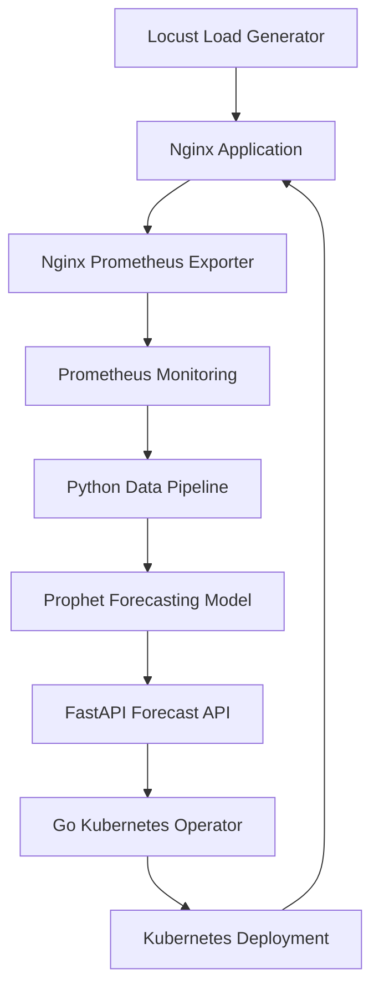

# Predictive Kubernetes Autoscaling Using Machine Learning

A machine learning-based Kubernetes autoscaling system that forecasts future application traffic using **Facebook Prophet** and proactively scales Kubernetes Deployments through a custom Go operator.

Unlike traditional reactive autoscaling, which responds to resource utilization after demand increases, this project uses historical request-rate metrics to predict upcoming workload and make scaling decisions in advance.

---

## 1. Project Overview

The system combines time-series forecasting, monitoring, container orchestration, and Kubernetes automation.

It uses:

- **Locust** to generate simulated application traffic.
- **Nginx** as the application workload.
- **Prometheus** to collect application metrics.
- **Nginx Prometheus Exporter** to expose Nginx metrics.
- **Python and Prophet** to forecast future request rates.
- **FastAPI** to expose forecasting results through a REST API.
- **Go and Kubernetes Controller Runtime** to implement a custom autoscaling operator.
- **Minikube** to run the local Kubernetes cluster.

### Key Features

- Real-time application metric collection.
- Time-series forecasting using Prophet.
- Configurable forecasting horizon.
- Dynamic replica recommendations based on predicted demand.
- Custom Kubernetes operator for automated scaling.
- Proactive scale-up and scale-down.
- Forecast evaluation using MAE and RMSE.
- Comparison against a persistence forecasting baseline.

---

## 2. System Architecture



### Component Responsibilities

| Component | Responsibility |
|---|---|
| Locust | Generates synthetic traffic patterns |
| Nginx | Serves application requests |
| Nginx Exporter | Exposes Nginx metrics |
| Prometheus | Scrapes and stores monitoring metrics |
| Python | Fetches historical RPS measurements |
| Prophet | Predicts future request rates |
| FastAPI | Exposes predictions through REST endpoints |
| Go Operator | Retrieves predictions and manages replica counts |
| Kubernetes | Creates, manages, and scales application pods |

### Data Flow

1. Locust generates requests against the Nginx application.
2. Nginx Exporter exposes application metrics.
3. Prometheus continuously collects those metrics.
4. The Python pipeline queries Prometheus for historical request rates.
5. Prophet trains on historical measurements and forecasts future demand.
6. FastAPI exposes the forecast and recommended replica count.
7. The Go operator periodically queries the FastAPI endpoint.
8. The operator updates the Kubernetes Deployment replica count.
9. Kubernetes reconciles the Deployment and adjusts the running pods.

---

## 3. Forecasting Strategy

The project uses Facebook Prophet for time-series forecasting.

### Input Metric

The primary metric is Requests Per Second (RPS).

Prometheus query:

```promql
rate(nginx_http_requests_total[1m])
```

### Model Configuration

| Parameter | Value |
|---|---|
| Historical data window | 10 minutes |
| Sampling interval | 5 seconds |
| Forecast horizon | 120 seconds |
| Seasonality | 5-minute simulated traffic cycle |
| Fourier order | 5 |
| Seasonality mode | Additive |

The five-minute seasonality is configured specifically for the simulated sine-wave workload.

### Replica Recommendation

The system currently assumes that each application replica can handle approximately 20 requests per second.

The recommended replica count is calculated as:

\[
\text{Replicas} =
\left\lceil
\frac{\text{Predicted RPS}}{20}
\right\rceil
\]

The recommendation is subsequently constrained by the minimum and maximum replica settings in the PredictiveAutoscaler resource.

---

## 4. Technology Stack

| Technology | Purpose |
|---|---|
| Python | Forecasting pipeline |
| Prophet | Time-series forecasting |
| Pandas | Data processing |
| Requests | Prometheus API communication |
| FastAPI | REST API |
| Go | Kubernetes operator |
| Controller Runtime | Kubernetes reconciliation |
| Kubernetes | Container orchestration |
| Minikube | Local Kubernetes cluster |
| Docker | Container runtime |
| Prometheus | Metrics collection |
| Nginx | Test application |
| Locust | Load generation |

---

## 5. Prerequisites

The following software should be installed:

- Windows 10/11
- Git
- Docker Desktop
- Minikube
- kubectl
- Python 3.11
- Go
- PowerShell

Make sure Docker Desktop is running before starting Minikube.

---

## 6. Installation and Setup

### Step 1: Clone the repository

```powershell
git clone YOUR_GITHUB_REPOSITORY_URL
cd YOUR_PROJECT_DIRECTORY
```

### Step 2: Start Minikube

```powershell
minikube start
```

Verify the Kubernetes context:

```powershell
kubectl config current-context
```

Expected:

```text
minikube
```

### Step 3: Deploy Kubernetes resources

Apply the Kubernetes manifests provided in the repository.

The setup includes:

- Nginx application Deployment and Service.
- Nginx status endpoint configuration.
- Nginx Exporter Deployment and Service.
- Prometheus Deployment, ConfigMap, and Service.
- PredictiveAutoscaler Custom Resource Definition.

For the operator resources:

```powershell
kubectl apply -f operator/config/crd.yaml
kubectl apply -f operator/config/demo_app.yaml
kubectl apply -f operator/config/scaler.yaml
```

If your repository uses a different manifest location, use the corresponding paths.

Verify the resources:

```powershell
kubectl get pods
kubectl get deployments
kubectl get services
kubectl get pa
```

Wait until the required pods are running.

### Step 4: Start port forwarding

Open separate PowerShell terminals.

**Terminal 1 — Prometheus**

```powershell
kubectl port-forward svc/prometheus 9090:9090
```

Prometheus UI:

http://localhost:9090

**Terminal 2 — Nginx application**

```powershell
kubectl port-forward svc/test-app 8082:80
```

Application:

http://localhost:8082

Keep both terminals running.

### Step 5: Set up the Python environment

From the project root:

```powershell
python -m venv venv
.\venv\Scripts\Activate.ps1
```

Install the dependencies:

```powershell
pip install prophet fastapi uvicorn requests pandas numpy locust
```

If a `requirements.txt` file is provided, you can instead install dependencies using:

```powershell
pip install -r requirements.txt
```

### Step 6: Start the forecasting API

From the project root:

```powershell
uvicorn main:app --reload
```

FastAPI documentation:

http://localhost:8000/docs

The forecasting endpoint is:

```http
GET /api/v1/forecast/{workload_name}
```

Example:

```http
GET http://127.0.0.1:8000/api/v1/forecast/test-app
```

Example response:

```json
{
  "target_workload": "test-app",
  "forecast_horizon_seconds": 120,
  "predicted_demand": 29.91,
  "confidence_lower": 29.53,
  "confidence_upper": 30.26,
  "recommended_replicas": 2
}
```

The values above are an example from a previous successful experiment.

### Step 7: Build and start the Go operator

Open another PowerShell terminal:

```powershell
cd operator
```

Download dependencies:

```powershell
go mod download
```

Build the operator:

```powershell
go build -o manager.exe main.go
```

Start it:

```powershell
.\manager.exe --metrics-bind-address=:8083
```

**Note:** Port 8083 is used here to avoid conflicts with the Nginx application port-forward on 8082 and the Oracle listener on 8080.

The operator periodically retrieves predictions from FastAPI and updates the target Deployment.

The current configuration expects FastAPI to be available at:

```text
http://127.0.0.1:8000
```

This configuration assumes the Go operator is running locally on the same host as FastAPI.

---

## 7. Running the Demonstration

### Step 1: Start Locust

From the project root:

```powershell
locust -f locust_script.py --host http://localhost:8082
```

Open:

http://localhost:8089

Start the load test through the Locust interface.

The sine-wave workload generates changing traffic to simulate varying application demand.

### Step 2: Observe Prometheus

Open:

http://localhost:9090

Execute:

```promql
rate(nginx_http_requests_total[1m])
```

This displays the application's request rate.

You can use the Prometheus graph to observe changes in incoming traffic.

### Step 3: Observe the forecasting API

Open:

http://localhost:8000/docs

Execute:

```http
GET /api/v1/forecast/test-app
```

Inspect:

- Predicted demand.
- Forecast confidence interval.
- Forecast horizon.
- Recommended replicas.

### Step 4: Observe the Go operator

Check the operator terminal.

The logs show the predicted demand and the replica recommendation.

For example:

```text
Received ML Forecast
predictedDemand: 21.64
recommendedReplicas: 2
```

When a scaling decision is made, the operator logs the current and desired replica counts.

### Step 5: Verify Kubernetes scaling

Run:

```powershell
kubectl get deployment test-app
```

To observe pods continuously:

```powershell
kubectl get pods -l app=test-app -w
```

The Deployment replica count should change according to the operator's recommendations.

---

## 8. Experimental Results

### Sine-Wave Workload

The project was tested using a simulated repeating traffic pattern.

An offline evaluation was performed using a historical dataset of approximately one hour.

The results were:

| Forecast Horizon | MAE (RPS) | RMSE (RPS) |
|---|---:|---:|
| 30 seconds | 0.5397 | 0.7109 |
| 60 seconds | 0.5356 | 0.6949 |
| 120 seconds | 0.5858 | 0.7168 |

### Comparison Against Persistence Forecasting

A persistence model was used as a baseline. It assumes that future request rates will remain equal to the most recently observed request rate.

| Horizon | Prophet MAE | Persistence MAE |
|---|---:|---:|
| 30 seconds | 0.5397 | 5.2676 |
| 60 seconds | 0.5356 | 9.7106 |
| 120 seconds | 0.5858 | 15.3147 |

Prophet outperformed the persistence baseline across all three evaluated horizons on the simulated sine-wave workload.

**Important:** These results are specific to the controlled synthetic workload and should not be interpreted as production forecasting accuracy.

### Autoscaling Verification

The following behaviours were successfully demonstrated:

- Scale-up from 1 to 2 replicas when predicted demand exceeded the assumed capacity of one replica.
- Scale-down from 2 to 1 replicas when predicted demand fell below that capacity.
- Successful reconciliation of Kubernetes Deployment replicas.

---

## 9. Project Structure

The main project components are organized as follows:

```text
PROJECT/
│
├── main.py
├── data_pipeline.py
├── evaluate_model.py
│
├── locust_script.py
├── locust_spike.py
│
├── prometheus_rps_history.csv
├── prometheus_rps_training.csv
├── prediction_evaluation_results.csv
├── model_comparison_results.csv
│
└── operator/
    ├── api/
    ├── config/
    ├── controllers/
    ├── main.go
    ├── go.mod
    ├── go.sum
    ├── Dockerfile
    └── README.md
```

Additional Kubernetes manifests, configuration files, and scripts may be present in the repository.

---

## 10. Troubleshooting

### Prometheus is not accessible

Check the port-forward:

```powershell
kubectl port-forward svc/prometheus 9090:9090
```

Check Prometheus targets:

http://localhost:9090/targets

The Nginx exporter target should be UP.

### FastAPI cannot connect to Prometheus

Make sure the Prometheus port-forward is running on port 9090.

Check the configured environment variable:

```text
PROMETHEUS_URL=http://localhost:9090
```

### Operator cannot connect to FastAPI

Check that FastAPI is running on port 8000.

Test:

```powershell
curl.exe http://127.0.0.1:8000/docs
```

Also verify the prediction URL in:

```text
operator/config/scaler.yaml
```

### Operator fails to start

Check for port conflicts.

For this setup, the operator uses metrics port 8083:

```powershell
.\manager.exe --metrics-bind-address=:8083
```

### Kubernetes pods are not starting

Check:

```powershell
kubectl get pods
kubectl describe pod POD_NAME
kubectl get events --sort-by=.metadata.creationTimestamp
```

---

## 11. Future Improvements

Potential future improvements include:

- Testing on irregular and unpredictable traffic patterns.
- Improving forecasting under sudden traffic spikes.
- Comparing Prophet against additional forecasting algorithms.
- Introducing confidence-aware scaling decisions.
- Adding scale-down stabilization.
- Validating the assumed per-replica request capacity.
- Comparing predictive autoscaling against Kubernetes HPA.
- Evaluating resource utilization, response latency, and scaling response time.
- Supporting deployment of the forecasting API inside Kubernetes.

---

## 12. Conclusion

This project demonstrates a predictive autoscaling architecture that combines time-series forecasting with Kubernetes automation.

By forecasting future application demand instead of relying exclusively on current resource utilization, the system aims to make scaling decisions proactively.

The implementation integrates a Python-based forecasting service with a custom Go Kubernetes operator, demonstrating an end-to-end machine learning-driven autoscaling pipeline.

**Built using Python, Prophet, FastAPI, Go, Prometheus, Docker, Locust, and Kubernetes.**